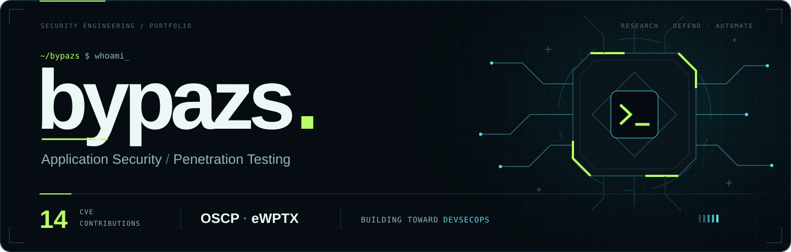

<!--
  👀 recon complete? decode me (base64):
  ZmxhZ3t5MHVfcjM0ZF90aDNfczB1cmMzfSAtIE5pY2UgcmVjb24uIFNheSBoaSBvbiBMaW5rZWRJbiB3aXRoIHRoaXMgZmxhZy4=
-->

<picture>
  <source media="(max-width: 600px) and (prefers-color-scheme: dark)" srcset="./banner-mobile.svg" />
  <source media="(max-width: 600px) and (prefers-color-scheme: light)" srcset="./banner-mobile-light.svg" />
  <source media="(prefers-color-scheme: dark)" srcset="./banner.svg" />
  <source media="(prefers-color-scheme: light)" srcset="./banner-light.svg" />
  
</picture>

## 👋 About

I'm a **penetration tester and application security professional with 6 years of cybersecurity experience**, including assessments for banking and enterprise clients. My work spans web, mobile, API and network security, vulnerability management, and collaboration with development teams on remediation and retesting.

I'm moving toward **DevSecOps**, bringing an attacker's perspective into secure development and delivery. I'm building practical experience with containers, CI/CD and security automation, alongside my professional security work.

- **Security research** — contributions across 14 published CVEs, with Finder and Analyst roles identified below.
- **Engineering focus** — reproducible findings, actionable remediation, and reviewable automation.
- **Based in Thailand** — interested in Application Security, Penetration Testing and DevSecOps opportunities.

---

## 🛠️ Featured Projects

### Profile Automation — public

A small, inspectable example of Python automation and GitHub Actions: CVE records in YAML generate the research tables and counters in this profile.

- **Implemented:** data validation, generated Markdown and SVG counters, a CI freshness check, and Markdown linting.
- **Evidence:** [renderer](scripts/render.py) · [CVE data](data/cves.yml) · [workflow](.github/workflows/update-profile.yml).
- **Scope:** profile maintenance automation; my broader CI/CD security learning continues below.

### AI Development Template — private · tooling and workflow design

A reusable starter kit for AI-assisted development, with documented implementation/review responsibilities, task handoffs, security checks and stack-specific guidance.

- **Implemented in the repository:** workflow documents, a staged bootstrap script that preserves existing files, and a structural verification script.
- **Design focus:** keeping changes reviewable and adapting the template to each project's existing rules.
- **Status:** private toolkit; v0.3 orchestration guidance is a proposal. Adoption and validation are tracked separately for each project.

### AI Bug Bounty Hunter — private · planning

A personal security research tooling project for authorized bug bounty work and open-source research in disposable, owned labs.

- **Designed so far:** authorization boundaries, benchmark-based tool selection and a human review workflow.
- **Next milestone:** evaluate candidate tools against a reproducible lab benchmark before choosing the implementation.
- **Status:** planning / Week 1. A working scanner and validated research results are future milestones.

Private project summaries describe their current scope and status; they do not provide publicly inspectable implementation evidence.

---

## Security Research

Contributions to published open-source vulnerability research. Featured advisories distinguish Finder and Analyst credits.

<!-- cve:start -->

### Featured

| CVE | Product | Vulnerability | CVSS | Role |
|:----|:--------|:--------------|:----:|:----:|
| [CVE-2026-23959](https://github.com/advisories/GHSA-fqcv-8859-86x2) | CoreShop | Error-based SQL Injection | 6.9 | Finder |
| [CVE-2026-22242](https://github.com/advisories/GHSA-ch7p-mpv4-4vg4) | CoreShop | Blind SQL Injection | 4.9 | Analyst |

<b>2022 – 2023 — 12 CVEs</b> (click to expand)

 

| CVE | Product | Vulnerability |
|:----|:--------|:--------------|
| [CVE-2023-26984](https://github.com/bypazs/CVE-2023-26984) | Peppermint 0.2.4 | Broken access control (IDOR) in password reset → account takeover |
| [CVE-2023-26982](https://github.com/bypazs/CVE-2023-26982) | Trudesk 1.2.6 | Stored XSS — ticket tags |
| [CVE-2022-42098](https://github.com/bypazs/CVE-2022-42098) | KLiK-SocialMediaWebsite 1.0.1 | SQL Injection — `profile.php?id` |
| [CVE-2022-42097](https://github.com/bypazs/CVE-2022-42097) | Backdrop CMS 1.23.0 | Stored XSS — comments |
| [CVE-2022-42096](https://github.com/bypazs/CVE-2022-42096) | Backdrop CMS 1.23.0 | Stored XSS — post content |
| [CVE-2022-42095](https://github.com/bypazs/CVE-2022-42095) | Backdrop CMS 1.23.0 | Stored XSS — page content |
| [CVE-2022-42094](https://github.com/bypazs/CVE-2022-42094) | Backdrop CMS 1.23.0 | Stored XSS — card content |
| [CVE-2022-34963](https://github.com/bypazs/CVE-2022-34963) | OSSN 6.3 LTS | Stored XSS — news feed |
| [CVE-2022-34962](https://github.com/bypazs/CVE-2022-34962) | OSSN 6.3 LTS | Stored XSS — group timeline |
| [CVE-2022-34961](https://github.com/bypazs/CVE-2022-34961) | OSSN 6.3 LTS | Stored XSS — user timeline |
| [CVE-2022-32114](https://github.com/bypazs/CVE-2022-32114) | Strapi 4.1.12 | Unrestricted file upload |
| [CVE-2022-32060](https://github.com/bypazs/CVE-2022-32060) | Snipe-IT 6.0.2 | Arbitrary file upload — branding settings |

**By class:** Stored XSS ×8 · SQL Injection ×3 · File Upload ×2 · Broken Access Control ×1

<!-- cve:end -->

---

## 🎓 Certifications

Primary credentials: **OSCP · eWPTX**.

| Track | Certifications |
|:------|:---------------|
| **Offensive** | OSCP · eWPTX · CRTA · PenTest+ · CEH |
| **Defensive & Architecture** | SecurityX · CySA+ · SAL1 |
| **Foundation** | Security+ · ECSS |
| **Stackable** | CSAP — CompTIA Security Analytics Professional |

---

## 🧰 Skills & Hands-on Practice

| Experience | Focus |
|:-----------|:------|
| **Professional security work** | Web, mobile, API and network penetration testing; application security; vulnerability management; remediation and retesting |
| **Security toolkit** | Burp Suite · Metasploit · Nmap · Frida · Ghidra · Wireshark · Kali Linux |
| **Scripting & automation** | Python · Bash · Linux; security and reporting workflows |
| **Hands-on labs & small projects** | Git · Docker fundamentals · GitHub Actions; experiments with NodeJSScan, Bandit, Trivy, SonarQube and OWASP ZAP |
| **Currently learning / planned** | GitLab CI/CD · Kubernetes · Terraform · cloud security, including AWS |

Lab experience is separate from production infrastructure ownership. Project links above show the work that is publicly inspectable.

---

## 🗺️ Roadmap: Pentest → DevSecOps

- [x] Offensive security foundation — professional assessments, OSCP and eWPTX
- [x] Python automation — data-driven profile generation with a CI freshness check
- [ ] Containers — Docker hardening and repeatable image scanning
- [ ] CI/CD security — a documented pipeline with SAST, DAST and secret scanning
- [ ] Kubernetes — workload security, RBAC and admission policies
- [ ] Infrastructure as Code — Terraform and policy checks
- [ ] Cloud — AWS security fundamentals and practical labs

---

<b>📊 GitHub Activity</b>

---

Research performed for defensive purposes. Advisory and PoC links are listed above.
 
<code>// there is more here than meets the eye — view the source</code>

